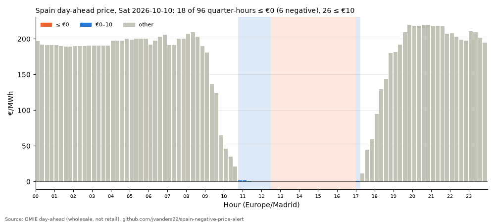

# spain-negative-price-alert

Every afternoon, as soon as OMIE publishes tomorrow's Spanish day-ahead power prices, a scheduled pipeline
flags the zero/negative and near-zero periods, appends them to a versioned CSV history, renders a chart,
publishes a JSON/RSS feed and a static page, and writes an X post **draft** (never posted automatically).

Why: zero-price days are now routine in Spain (solar at midday), but most tools are retail/PVPC apps that
update around 20:15. The OMIE day-ahead result is public ~7 hours earlier, at quarter-hour resolution. This
repo turns it into a small, tested, idempotent data pipeline.

## How it works

```
 GitHub Actions (7 UTC crons ≈ 13:17 / 13:47 / 14:47 / 16:17 Madrid)
        │
        ▼
 negprice run ── already in daily.csv? ──yes──▶ exit 0 "already processed" (no network)
        │ no
        ▼
 OMIE marginalpdbc_<D+1>.1 (.2, .3 … fallback) ── all 404 ──▶ "pending" (exit 0) / exit 1 after 16:00
        │ 200
        ▼
 parse ─▶ validate (period count from calendar, UTC timestamps, -500..4000 €/MWh)
        │
        ▼
 classify (≤0, <0, ≤10 €/MWh) ─▶ summarise (windows, cheapest 3h, midday/evening, YTD counts)
        │
        ▼
 data/history/periods.csv + daily.csv   (upsert by delivery date, byte-stable)
        │
        ▼
 site/latest.json  site/feed.xml  site/charts/<date>.png  site/index.html   drafts/<date>.md
        │
        ▼
 commit by github-actions[bot] ─▶ (optional) GitHub Pages deploy of site/
```

Code: `src/negprice/` — `omie.py`/`http.py` (vendored fetch + parse), `summary.py` (pure classification
and validation), `history.py` (CSV store), `outputs.py` (JSON/RSS/PNG/HTML/draft files), `draft.py`
(post text), `cli.py`. Retail estimate: `tariffs.py` (official 2026 tables and period calendars),
`retail.py` (formula, cheapest windows), `pvpc.py` (PVPC context), `retail_site.py` (site files).

## Definitions

- **Time:** delivery dates and displayed times are Europe/Madrid; timestamps are stored in UTC.
  Windows are `HH:MM–HH:MM` local, end exclusive (`24:00` = midnight at the end of the day). All period
  arithmetic is done in UTC, so DST days (23 or 25 hours) need no special cases.
- **Periods:** OMIE's native resolution — 15-minute periods since 2025-10-01 (96 per day; 92 on the
  spring-forward day, 100 on the fall-back day), hourly before (24; 23/25). Headline counts use the native
  resolution, so counts before and after 2025-10-01 are not directly comparable.
- **le0:** `price_es <= 0`. **neg:** `price_es < 0`. **cheap:** `price_es <= 10.0` €/MWh (fixed).
- **Zero-price day:** a delivery day with at least one le0 period.
- **Cheapest 3h:** the contiguous 180-minute span (real minutes, UTC) with the lowest mean price; earliest
  wins ties. It is the headline on days with no le0 periods.
- **Midday / evening:** mean price of periods starting 10:00–17:59 / 19:00–22:59 local; the spread is
  evening minus midday.
- **YTD:** zero-price days from 1 Jan of D's year up to and including D. **Same period last year:** from
  1 Jan of the previous year up to the same month/day. **Last 365 days:** D-364 … D. All from history.
- Prices are rounded to 2 dp.

## Schedule and DST

GitHub cron is UTC-only, so the workflow lists both the CET (UTC+1) and CEST (UTC+2) equivalents of
13:17, 13:47, 14:47 and 16:17 Madrid (seven distinct UTC times; the mapping is commented in
`.github/workflows/alert.yml`). Times are off the hour because GitHub delays/drops top-of-hour jobs.
Extra runs are cheap: they exit early as "already processed" or "pending". SDAC results are normally out
~13:05 Madrid (latest 14:20; decoupled local results from 15:00), so `--deadline 16:00` makes the
16:17 run fail loudly — notifying the workflow owner — if the file is still missing.

Manual runs: Actions → daily-alert → Run workflow, with optional `date`, `force`, and `dry_run` (run but
don't commit). The Pages deploy job exists but is disabled unless the repo variable `PAGES_ENABLED` is
`true` (Pages on the Free plan needs a public repo).

## Outputs

| Path | What |
|---|---|
| `data/history/periods.csv` | one row per period: `date, ts_utc, mtu_min, price_es, price_pt, source` |
| `data/history/daily.csv` | one row per delivery day: counts, min/mean/max, midday/evening, cheapest 3h, file version |
| `site/latest.json` | latest day's full summary, `schema_version` 1, schema in `src/negprice/latest.schema.json` |
| `site/feed.xml` | RSS 2.0, newest 30 days; titles start `ALERT:` on zero-price days, else `Cheapest 3h:` |
| `site/charts/<date>.png`, `site/charts/latest.png` | one bar per period; ≤0 and ≤10 € periods highlighted |
| `site/index.html` | static page (no external JS/CSS/fonts): latest day, chart, 30-day strip, YTD |
| `drafts/<date>.md` | X post draft (≤280 chars) + the facts it was built from. Not published, not under `site/` |
| `site/estimate/latest.json`, `site/estimate/<date>-2.0TD.csv`, `-3.0TD.csv` | retail price **estimate** for the latest day, per period |
| `site/wholesale-vs-bill.html` | "Wholesale is not your bill" explainer with a worked example from the latest day |
| `data/pvpc/<date>.json` | cached raw PVPC responses (ESIOS archive 70), context column only |

Charts and drafts are drawn for the processed day and the latest day only (not for every backfilled day).
All outputs are derived from `data/history/` and contain no wall-clock timestamps, so re-running a day or
running `rebuild` leaves them byte-identical.

## Retail estimate

A €0 wholesale price is not a €0 bill. `negprice estimate` turns a stored day into an **estimated** price
paid per kWh for the 2.0TD, 3.0TD or 6.1TD access tariff (peninsula): OMIE price plus assumed adjustment
services, losses and retailer margin, plus the official 2026 peajes and cargos for the tariff period of
each quarter-hour, plus IEE and IVA. It then compares the cheapest window by estimated price with the
cheapest wholesale window.

```bash
negprice estimate --date 2026-10-09                        # 2.0TD, default assumptions
negprice estimate --date 2026-10-09 --tariff 3.0TD --margin 5 --no-pvpc --csv out.csv
```

Example, Fri 9 Oct 2026, 2.0TD: the cheapest wholesale 3 hours are 11:15–14:15 at 0.00 €/MWh, but most
of that is punta, so it would cost an estimated 0.172 €/kWh. The cheapest estimated 3 hours are
14:00–17:00 (llano) at 0.091 €/kWh. On Sat 10 Oct (all valle) both rankings pick 13:30–16:30.

The same numbers for the latest day are on the site page, with the explainer
`site/wholesale-vs-bill.html`. Tables, sources (BOE ids), formula, assumptions and limits:
[docs/tariffs.md](docs/tariffs.md). It is an estimate built on stated assumptions, for 2026 only, without
the power term; it is not a bill and not advice. PVPC is shown as a before-tax context column.

## Run locally

```bash
python -m venv .venv && .venv/bin/pip install -e ".[dev]"
source .venv/bin/activate

# one-off history: hourly days before 2025-10-01 from spain-power-prices' hourly.parquet (needs pyarrow)
negprice seed --parquet /path/to/hourly.parquet
# then 15-minute days from OMIE, ~1 request/second, skipping dates already present
negprice backfill --start 2025-10-01 --end 2026-10-09 --sleep 1.0

negprice run                                   # tomorrow (Europe/Madrid)
negprice run --date 2026-10-10 --force         # reprocess a day
negprice run --file tests/fixtures/marginalpdbc_20261010.1   # offline, from a local file
negprice rebuild                               # daily.csv + site/ + latest draft from periods.csv, no network
negprice estimate --date 2026-10-10            # retail price estimate for a stored day (see above)

ruff check . && ruff format --check . && pytest -q   # tests use fixtures only, no network
```

Every command takes `--root DIR` (default: current directory). `backfill` keeps going past single-day
failures, prints a report and exits 1 if any day failed.

## Sample output

First real run, for delivery day **Sat 10 Oct 2026** (OMIE file `marginalpdbc_20261010.1`):

| | |
|---|---|
| Periods ≤ €0 | **18 of 96** quarter-hours, 12:30–17:00 |
| Negative periods | 6 (15:00–16:30), low **−0.01 €/MWh** at 15:00 |
| Periods ≤ €10 | 26 (10:45–17:15) |
| Cheapest 3 h | 13:30–16:30, mean −0.01 €/MWh |
| Midday vs evening mean | 7.01 vs 209.15 €/MWh (spread 202 €/MWh) |
| Zero-price days | #151 of 2026 vs 111 by the same date in 2025 |



Generated X draft (`drafts/2026-10-10.md`, not posted):

```text
Sat 10 Oct: Spain's day-ahead power hits €0 or below for 18 of 96 quarter-hours, 12:30–17:00. Low: -€0.01/MWh. Evening: ~€209.

Zero-price day #151 of 2026 (111 by this date in 2025).

A battery doesn't need cheap power. It needs the gap between noon and 9pm.

Source: OMIE
```


## Data source and attribution

Prices: **OMIE** ([omie.es](https://www.omie.es)), day-ahead market marginal prices for the Spanish zone
(`marginalpdbc` files; the Portuguese price is stored too). Reuse is permitted with attribution per OMIE's
legal notice: <https://www.omie.es/en/legal-warning>. Outputs carry the line "Prices: OMIE (omie.es),
day-ahead market, Spain zone. Wholesale prices, not your retail bill."

`src/negprice/omie.py` and `src/negprice/http.py` are vendored from the author's
`jvanders22/spain-power-prices` (MIT); local changes are marked `# local change:`.

## Limits

- **Wholesale, not retail.** A zero or negative day-ahead price is not a free electricity bill; retail
  tariffs add network charges, taxes and margins. The retail figures are estimates with their own limits
  (see [docs/tariffs.md](docs/tariffs.md)).
- A file republished by OMIE as `.2` after a day was processed is not picked up automatically; rerun with
  `--force`, which probes for and uses the highest published version (recorded in `daily.csv` and `latest.json`).
- GitHub's schedule can be delayed or skipped under load; the multiple crons are the mitigation.
- History mixes hourly (before 2025-10-01) and 15-minute periods. The committed history was seeded with hourly
  days 2024-10-01 to 2025-09-30 from `spain-power-prices`' `hourly.parquet` (OMIE-derived) and backfilled once
  with 15-minute OMIE files from 2025-10-01. Year-on-year counts therefore compare mostly hourly 2025 days
  with 15-minute 2026 days, which flags slightly more often.
- On the autumn fall-back day, times in the repeated 02:00 hour are tagged `CEST`/`CET` in window strings.
- No forecasting: it reports the published day-ahead result only.
- Drafts are never posted; a human approves every post.

## License

MIT — see [LICENSE](LICENSE).
